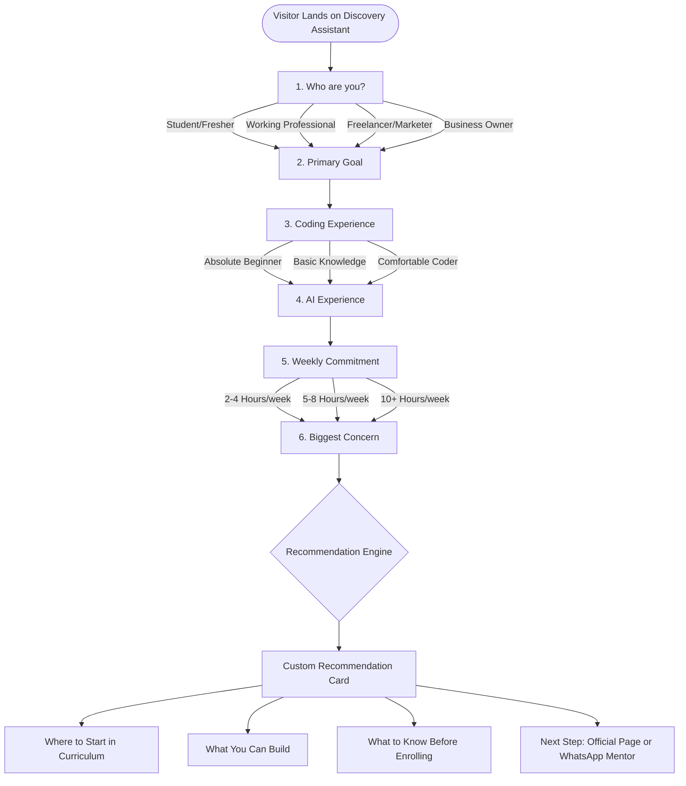

# Course Discovery Conversation Flow & Recommendation Logic

---

## 1. The 6 Discovery Decision Points

The discovery assistant guides the user through 6 fast, tap-friendly qualification questions to understand their context and deliver a realistic recommendation.

```
Step 1: Background (Who are you?)
├── Student or Fresher
├── Working Professional
├── Freelancer or Marketer
└── Business Owner

Step 2: Primary Goal (What do you want to achieve?)
├── Build a portfolio project for job/internship proof-of-work
├── Offer AI MVP and automation services to freelance clients
├── Build and launch my own software product / startup MVP
└── Automate repetitive bottlenecks in my existing business

Step 3: Coding Background (What is your coding experience?)
├── Absolute beginner (never written code)
├── Basic knowledge (know some HTML, Python, or logic)
└── Comfortable programmer (familiar with full-stack concepts)

Step 4: AI Experience (How have you used AI so far?)
├── Only basic ChatGPT / Claude prompts
├── Experimented with APIs, n8n, or AI code editors (Cursor/Copilot)
└── Completely new to AI tools

Step 5: Weekly Time Commitment (How many focused hours can you give?)
├── 2 to 4 focused hours per week
├── 5 to 8 focused hours per week
└── 10+ focused hours per week

Step 6: Biggest Concern (What makes you hesitate?)
├── "I have no coding background—will I get stuck?"
├── "Access is only 3 months—will I run out of time?"
├── "There are no live classes—will I have enough support?"
└── "Will this actually help me get an outcome vs free videos?"
```

---

## 2. Mermaid Flow Diagram



---

## 3. Recommendation Logic Matrix

The engine combines the answers to customize 4 sections on the recommendation card:

### A. "Where to Start" (Based on Background & Coding Level)
- **Beginner Coder:** Start with *AI & Product Foundations* and *Product Thinking & PRDs*. This ensures you understand how to structure a product spec before asking AI to generate code.
- **Intermediate / Experienced Coder:** Fast-track through foundations and jump directly to *AI-Assisted Development*, *RAG & Knowledge Layers*, and *Agents & Automation*.
- **Freelancer / Marketer:** Focus immediately on *Full-Stack MVP Engineering* and the *Commercial Framework (Audit -> Pilot -> System)*.
- **Business Owner:** Focus on *Agents & Automation*, *MCP & APIs*, and internal workflow systems like *CallTrack* (CRM automation).

### B. "What You Can Build" (Based on Primary Goal)
- **Portfolio / Job Search:** Deployed full-stack web MVPs with Supabase auth and database layers, live GitHub repositories, and recorded demo case studies. *(Note: Page does not guarantee job placement; portfolio is for self-demonstrated proof of work).*
- **Freelance Client Services:** AI-augmented landing pages, automated lead capture pipelines (n8n/webhooks), and custom knowledge retrieval (RAG) bots.
- **Own Startup Product:** Functional MVPs (like tools Sahil unpacked: video tools, thumbnail generators, CRM trackers) deployed on Vercel.
- **Business Automation:** Automated internal agents that eliminate manual data transfer and routine lead routing.

### C. "What to Keep in Mind" (Honest Pre-Purchase Warnings based on Concern & Time)
- **If concerned about coding:** Remind them that the course starts without assuming coding, using Cursor and Copilot to bridge the gap, but they must actively practice every week.
- **If 2-4 hours/week:** Caution them that 3 months equals ~12 weeks. With 2-4 hours a week, they have 24-48 total hours, so they should stick to 1 focused project rather than attempting all 9 stack areas.
- **If concerned about no live classes:** Clarify that all lessons are pre-recorded in Edrilla for flexible scheduling, but mentor Q&A is available in the learner community.
- **If concerned about refund:** Clarify that the 30-day money-back guarantee requires active participation and implementation proof, not a no-questions-asked cancellation.

---

## 4. Three Detailed User Journeys (Start to Finish)

### User Journey 1: College Fresher with No Coding Seeking a Portfolio Project
- **User Profile:** Aman, 3rd-year B.Tech / BCA student. Never built a full web app. Wants a standout project for internship interviews.
- **Selections:**
  1. *Who:* Student or Fresher
  2. *Goal:* Build a portfolio project for job/internship proof-of-work
  3. *Coding:* Absolute beginner (never written code)
  4. *AI Experience:* Only basic ChatGPT prompts
  5. *Time:* 5 to 8 focused hours per week
  6. *Worry:* "I have no coding background—will I get stuck?"
- **Assistant Recommendation Card Output:**
  - **Verdict:** **High Match with Focused Pacing.**
  - **Where to Start:** *AI & Product Foundations* followed by *Product Thinking & PRDs*. Learn to break ideas into functional specs before touching code.
  - **What You Can Build:** A deployed web MVP with a live public URL (e.g. using Cursor, Supabase, and Vercel) and an open-source GitHub repository to show recruiters.
  - **Before You Buy:** The course is 100% self-paced with 3 months access. It will NOT guarantee you an internship or job (any such claim is unverified). Your results depend on publishing real code and demo videos.
  - **Next Step:** [Enrol on Official Page (Rs 2,999)](https://cohort.lapaas.com/) or [Ask Mentor on WhatsApp](https://wa.me/919540065704).

---

### User Journey 2: Freelance Marketer Wanting to Sell AI Services
- **User Profile:** Priya, freelance performance marketer. Wants to offer AI chatbots and automated landing systems to clients to increase retainers.
- **Selections:**
  1. *Who:* Freelancer or Marketer
  2. *Goal:* Offer AI MVP and automation services to freelance clients
  3. *Coding:* Basic knowledge (knows some HTML/CSS)
  4. *AI Experience:* Experimented with APIs and n8n
  5. *Time:* 5 to 8 focused hours per week
  6. *Worry:* "Will this actually help me get an outcome vs free videos?"
- **Assistant Recommendation Card Output:**
  - **Verdict:** **High Match for Service Expansion.**
  - **Where to Start:** *MCP, APIs & Integrations* and *Agents & Automation*, then study the *Commercial Framework (Audit -> Pilot -> System)*.
  - **What You Can Build:** Client lead automation pipelines in n8n, automated CRM follow-up systems, and custom knowledge-base search tools for small businesses.
  - **Before You Buy:** The course gives you the technical systems, but the page explicitly notes that client revenue depends on your own sales, client acquisition, and execution. Access is 3 months inside the Edrilla app.
  - **Next Step:** [Review Full Syllabus on Cohort Page](https://cohort.lapaas.com/) or [Message Sahil on WhatsApp](https://wa.me/919540065704).

---

### User Journey 3: Small Business Owner Wanting Internal Automation
- **User Profile:** Rajesh, runs a distribution agency with 8 staff. Spends hours manually coordinating customer requests and updating sheets.
- **Selections:**
  1. *Who:* Business Owner
  2. *Goal:* Automate repetitive bottlenecks in my existing business
  3. *Coding:* Absolute beginner
  4. *AI Experience:* Completely new to AI tools
  5. *Time:* 2 to 4 focused hours per week
  6. *Worry:* "Access is only 3 months—will I run out of time?"
- **Assistant Recommendation Card Output:**
  - **Verdict:** **Moderate Match — Require Focused Scope.**
  - **Where to Start:** *AI-Assisted Development* and the *CallTrack CRM & Automation* case study. Skip deep programming and focus on workflow connectors.
  - **What You Can Build:** Automated lead intake, WhatsApp/email routing agents, and internal database dashboards via Supabase.
  - **Before You Buy:** At 2-4 hours per week, you will have roughly 24 to 48 hours before your 3-month access expires. Focus strictly on 1 internal business workflow instead of trying to study the entire technical stack.
  - **Next Step:** [Verify Your Use-Case on WhatsApp with Sahil](https://wa.me/919540065704) before purchasing.
